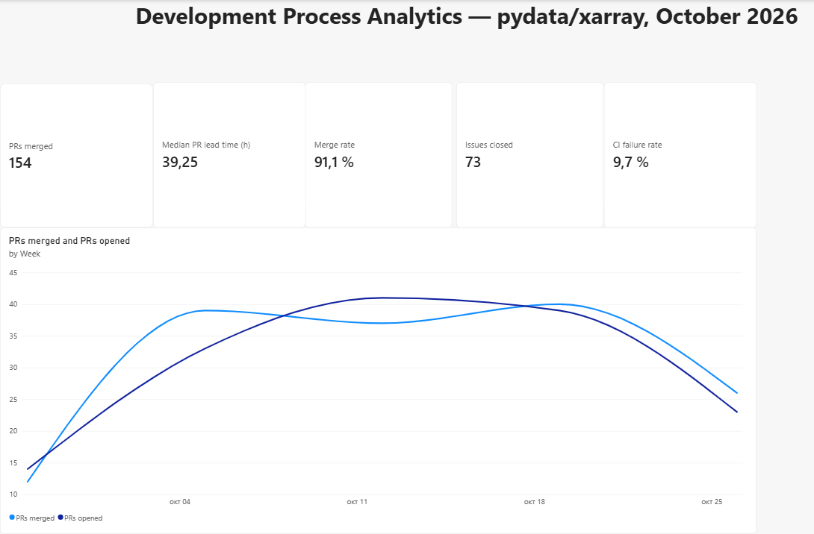

# Development Process Analytics

**How fast does an open-source team turn ideas into merged code, where does work wait, and how often does the build break?**

Work in progress. The goal is a Qlik Sense dashboard that combines three
sources from a public GitHub repository (issues, pull requests and GitHub
Actions CI runs) on one shared calendar, with every dashboard KPI recomputed
independently in Python to validate the numbers.

## Status

- [x] Project setup
- [x] GitHub API client with pagination, rate-limit handling and retries
- [x] Extract issues, pull requests and CI runs to CSV
- [x] KPI calculations in Python
- [ ] Qlik Sense data model and dashboard
- [x] Power BI dashboard: Overview page (see [`powerbi/`](powerbi/))
- [ ] Validation: Qlik vs Python

## Dashboard (Power BI)



pydata/xarray, October 2026: 154 pull requests merged, median lead time of
39 hours from opening to merge, 91 % of closed pull requests merged, 9.7 % of
completed CI runs on `main` failed. The first and last weeks of the line chart
are partial weeks of the month, which explains the lower counts at both ends.

Data extracted with
`python -m devstats.extract --repo pydata/xarray --since 2026-10-01 --until 2026-10-31 --skip-reviews --ci-branch main`
(review data skipped, CI limited to the `main` branch).

## Extract the data

```bash
export GITHUB_TOKEN=...   # Windows PowerShell: $env:GITHUB_TOKEN="..."
python -m devstats.extract --repo pydata/xarray --since 2026-05-01 --until 2026-10-31
```

Writes `pull_requests.csv`, `issues.csv`, `labels.csv`, `ci_runs.csv`,
`window.csv` and `meta.json` to `data/`. All timestamps are UTC. Options:
`--skip-reviews`, `--ci-branch main`, `--ci-event push`, `--out folder`.

## Recompute the KPIs in Python

```bash
python -m devstats.kpis --data data --out results
```

Writes `results/kpi_summary.csv`, `results/kpi_weekly.csv` and
`results/kpi_summary.md`. Every KPI follows the same rules as the dashboard:
events inside the window (UTC), weeks starting on Monday, bot authors
excluded, CI outcome `pass` / `fail` with cancelled and skipped runs ignored.
If Power BI and Python disagree, one of them has a bug.

## Development

```bash
pip install -r requirements.txt
python -m pytest
```

## License

MIT
