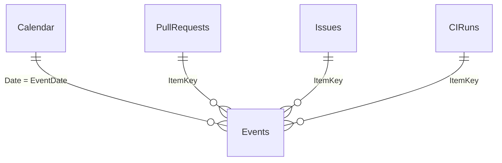

# Power BI version of the dashboard

The same KPIs as the Qlik Sense app, built in Power BI Desktop on the same CSV
files. Status: data model, measures and the Overview page are done
([screenshot](../screenshots/powerbi-overview.png)); Flow, Quality and Backlog
pages follow.

## Model

`Events` holds one row per event inside the analysis window (`PR opened`,
`PR merged`, `PR closed`, `Issue opened`, `Issue closed`, `CI run`) with the
values each KPI needs. Every measure filters `Events[EventType]`, so all charts
share one date axis, and every relationship filters in one direction only.
This is the Power BI counterpart of the canonical-date bridge in the Qlik app.

## Build it

1. Install **Power BI Desktop** (free, Windows).
2. **Home > Transform data > Manage parameters > New parameter:** name
   `DataFolder`, type *Text*, value = the folder with the CSV files, ending with
   a backslash (e.g. `C:\projects\dev-process-analytics\data\`).
3. For each section of [`power_query.m`](power_query.m): **New source > Blank
   query > Advanced editor**, paste the code and rename the query exactly as in
   the section title (`LoadCsv`, `ParseTs`, `Window`, `PullRequests`, `Issues`,
   `CIRuns`, `Events`, `Calendar`). Right-click `LoadCsv`, `ParseTs` and
   `Window` and untick **Enable load**.
4. **Close & apply.** In **Model view** create the relationships shown above
   (one-to-many, single direction) and mark `Calendar` as a date table on `Date`.
5. Add the measures from [`dax_measures.md`](dax_measures.md).
6. Build the pages: **Overview** (cards + PRs opened vs merged by `Calendar[Week]`),
   **Flow** (lead time and time to first review by week; slowest PRs from
   `PullRequests`), **Quality** (CI failure rate by week; runs by `CIWorkflow`),
   **Backlog** (issues opened vs closed by week).
7. Compare the Overview cards with the Python KPI check and save screenshots to
   `screenshots/powerbi-*.png`.

## If something fails

- *DataSource.NotFound*: `DataFolder` must end with a backslash.
- *Expression.Error ... ParseTs*: the query names must match exactly.
- Empty visuals: check the relationship `Calendar[Date]` → `Events[EventDate]`.
